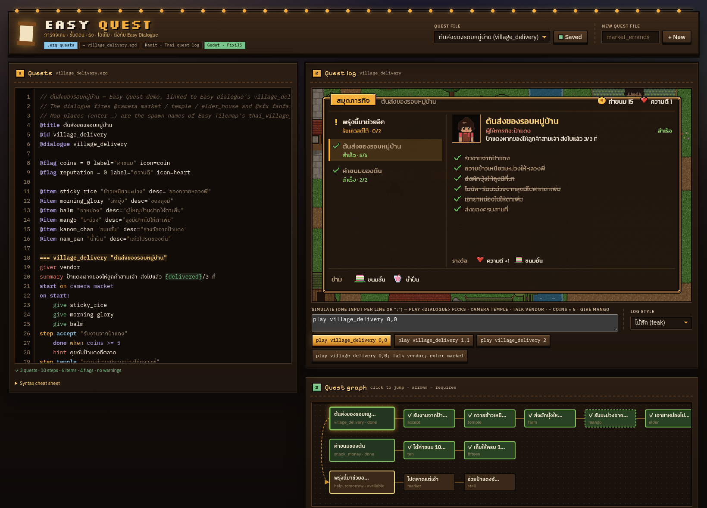
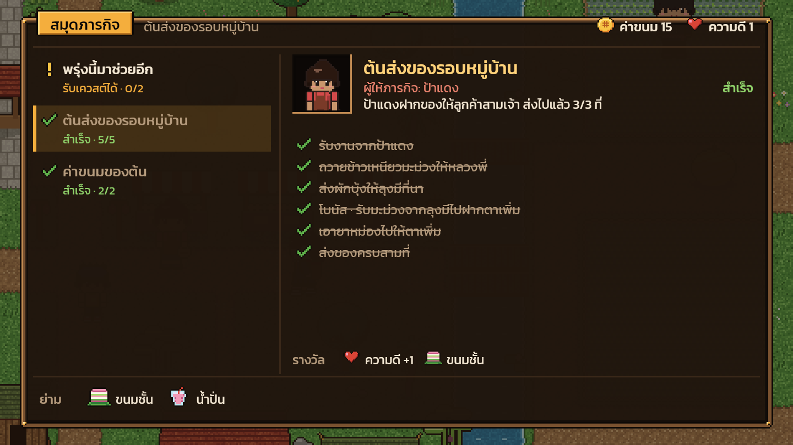
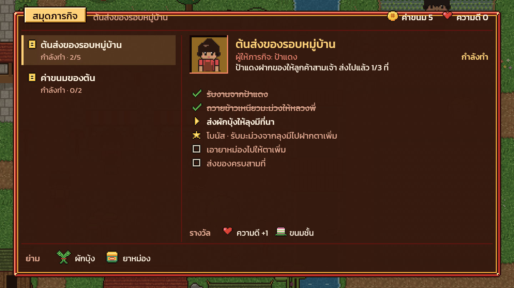
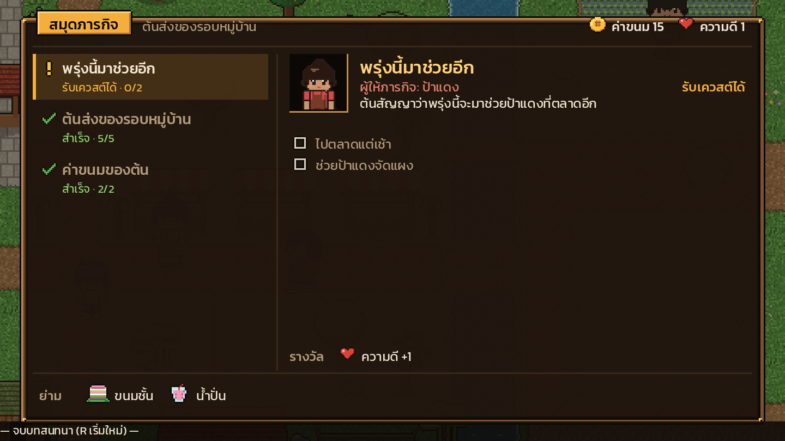
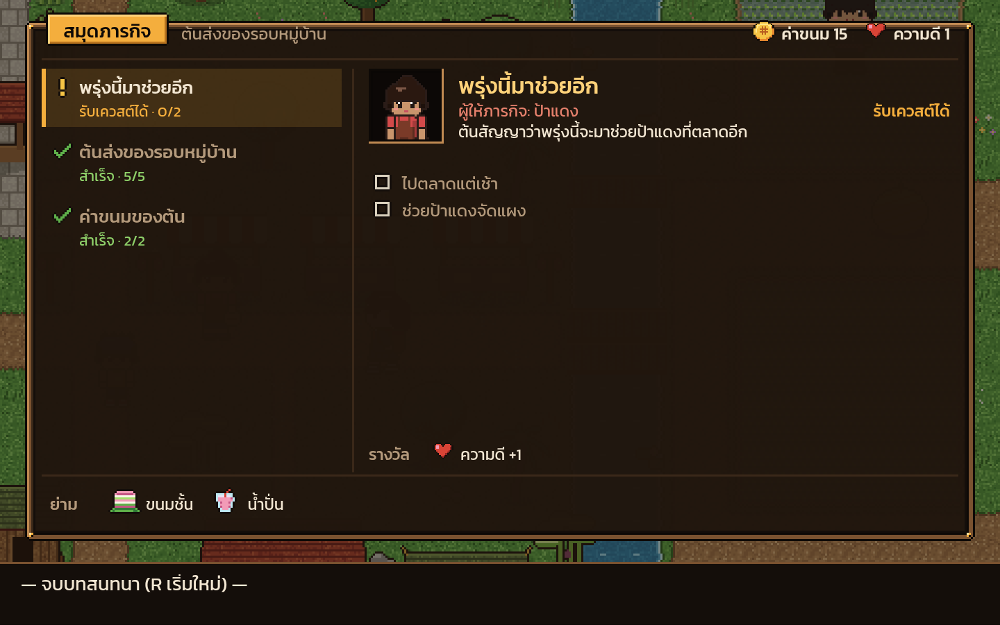
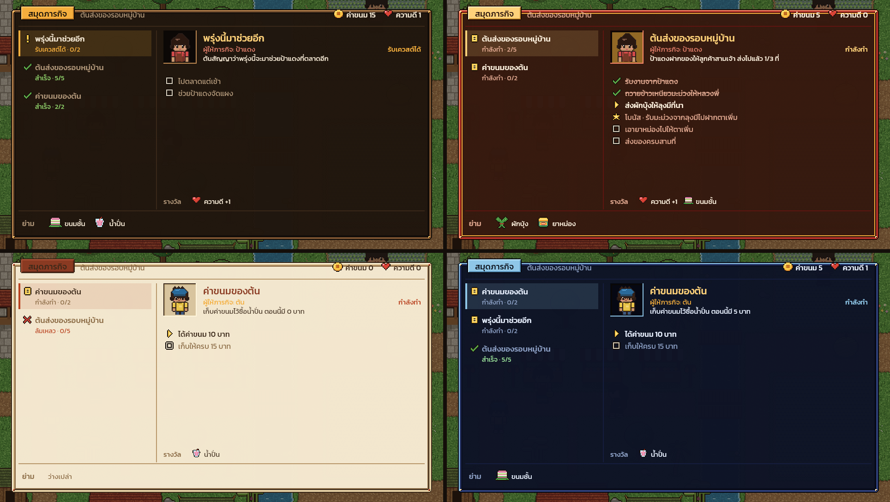

<p align="center">
  
</p>

# Easy Quest

**ภารกิจเกม · ขั้นตอน · ธง · ไอเท็ม · รางวัล — ต่อกับ Easy Dialogue ได้ทันที**  
Write game quests as plain text (`.ezq`): steps, flags, items, rewards and prerequisites. Easy Quest checks
them against your [Easy Dialogue](https://github.com/Saladin2020/easydialogue) scripts, plays them through a
simulator, draws a Thai pixel quest log, and exports a **Godot 4.3+** autoload, a **PixiJS v8** quest manager
or JSON. It joins [Easy Sprite](https://github.com/Saladin2020/easysprite) (characters),
[Easy Scene](https://github.com/Saladin2020/easyscene) (levels), Easy Tilemap (top-down maps) and
Easy Dialogue (conversations).

[](LICENSE)
[](https://nodejs.org)
[](#export)
[](docs/MCP.md)

> Easy Quest **writes · checks · simulates · renders · exports**. It has no AI generation in the app.

<p align="center">
  
</p>

<p align="center">
  
  
</p>

## What you get

* **`.ezq` quest files**: quests, steps (required or bonus), flags, items, rewards, `requires`
  prerequisites, start and fail triggers, plus `on start:` and `on fail:` effects. Thai text works everywhere.
* **A validator with line numbers**. It catches unknown flags, items, quests and steps (with
  *did you mean …?*), prerequisite cycles, steps with no `done` line, and quests with no required step. It
  warns when a step waits for an event the linked dialogue never fires, or when a giver is not in the cast.
* **Easy Dialogue interop**. Easy Quest reads `.ezd` files (or compiled `.dialogue.json`). Dialogue
  `@events` complete steps, dialogue variables *are* quest flags (one namespace), the cast supplies quest
  givers and portraits, and `end <dialogue>` fires when a conversation finishes. See
  [the contract](docs/QUEST_FORMAT.md#easy-dialogue-contract).
* **A simulator**: `easyquest play` runs the real Easy Dialogue runner with picks, or takes events typed by
  hand. It prints the quest log, statuses, flags and items.
* **A quest-log PNG** (480×270 × scale, Kanit, four frame styles). The same drawing code runs in the
  editor preview, the Pixi export and the CLI renderer, and the Godot `QuestLog` control mirrors it.
* **Exports**:
  * Godot: a `QuestManager` autoload with signals, a `QuestLog` control and the Easy Dialogue runner.
  * PixiJS: a JS `QuestManager`, `QuestLogView` and dialogue bridge.
  * Both come with a playable demo.
* **A web editor**: highlighted `.ezq` with an error gutter, a live quest log, a quest graph (steps per
  quest plus `requires` arrows, coloured by simulated state), state and log, export, and the dialogue
  contract.
* **An MCP server** with 7 tools, over stdio or Streamable HTTP.

<p align="center">
  
  
</p>

## Quick start

```bash
npm install
npx tsx src/cli.ts init --workspace ./my-quests      # demo quest + Easy Dialogue script, portraits, background
npx tsx src/cli.ts serve --workspace ./my-quests     # editor → http://127.0.0.1:8818/
```

Dev mode: `npm run dev` (API on 8818) + `npx vite --config web/vite.config.ts` (UI on 5177).

## Quests in 20 lines

```ezq
@title ต้นส่งของรอบหมู่บ้าน
@dialogue village_delivery                 // reads dialogues/village_delivery.ezd
@flag reputation = 0 label="ความดี" icon=heart
@item sticky_rice "ข้าวเหนียวมะม่วง"

=== village_delivery "ต้นส่งของรอบหมู่บ้าน"
giver vendor                               // cast id from the .ezd → name + portrait
summary ส่งไปแล้ว {delivered}/3 ที่          // delivered is a dialogue variable
start on camera market                     // the dialogue's @camera market
on start:
    give sticky_rice
step temple "ถวายข้าวเหนียวให้หลวงพี่"
    done on camera temple
    hint วัดอยู่ทางทิศตะวันตกเฉียงเหนือ
    take sticky_rice
step report "ส่งของครบสามที่"
    done when delivered >= 3
fail on end village_delivery               // the conversation ended before the quest finished
reward:
    ~ reputation += 1
```

Full reference: **[docs/QUEST_FORMAT.md](docs/QUEST_FORMAT.md)**.

## CLI

| Command | What it does |
| --- | --- |
| `easyquest init` | Create `quests/ dialogues/ portraits/ backgrounds/ exports/` with the demo |
| `easyquest check <file> [--strict] [--json]` | Validate; prints `file.ezq:line: message`; exit 1 on errors |
| `easyquest play <file> --picks 0,0` | Play the linked dialogue with picks and run the quests (exact ordering) |
| `easyquest play <file> --events "camera market; ~ coins = 5; give mango"` | Feed events by hand (`--file`, `--stdin` too) |
| `easyquest render <file> --picks 0,0 --quest id --style lantern --scale 3` | Quest-log PNG |
| `easyquest export <file> --preset godot\|pixi\|json\|all [--picks 1,1]` | Exports (the demo auto-plays the picks) |
| `easyquest dialogue <id>` | Show the contract read from an `.ezd`: cast, vars, events |
| `easyquest triggers <file>` | Every trigger the game or dialogue must send |
| `easyquest compile <file>` · `info` · `list` · `serve` | |

`easydialogue play --picks … --vars` prints every event first and the variables only at the end, so piping
it in loses the ordering between them. `easyquest play --picks` runs the compiled dialogue itself and syncs
the variables at every event. If an `.ezd` is newer than its `.dialogue.json`, set
`EASYQUEST_EASYDIALOGUE_CLI=/path/to/easydialogue/dist/cli.js` and Easy Quest will recompile it.

## Export

**Godot 4.3+** (`exports/<id>-godot/`): open it in Godot, or run it headless.

* `addons/easyquest/quest_manager.gd` is registered as the **`QuestManager`** autoload.
  * Methods: `load_file()`, `emit_event(name, args)`, `set_flag()`, `give()`, `take()`, `status()`,
    `current_step()`, `get_state()` / `load_state()` (save games).
  * Easy Dialogue hooks: `connect_dialogue(runner, id)` and `dialogue_ended(runner, id)`.
  * Signals: `quest_available`, `quest_started`, `step_completed`, `quest_completed`, `quest_failed`,
    `item_changed`, `flag_changed`, `quest_event`, `changed`.
* `addons/easyquest/quest_log.gd` is a `Control` that draws the quest log and redraws on `changed`
  (↑/↓ selects a quest).
* `addons/easydialogue/dialogue_runner.gd` is the Easy Dialogue runner (vendored, MIT).
* `main.tscn` plays the dialogue, with the quest log on top.
* Commands:
  * Headless check: `godot --headless --path . --script res://test_quests.gd -- picks=0,0`
  * Screenshot: `godot --path . -- screenshot=/tmp/q.png`

**PixiJS v8** (`exports/<id>-pixi/`): serve the folder and open `index.html`. The files:

* `easyquest-manager.js`: `QuestManager`, `bridgeDialogue(manager, runner, id)` and `simulate()`. It has no
  dependencies.
* `easyquest-pixi.js` + `easyquest-log.js`: `QuestLogView.create(PIXI, {scale, style})`, then
  `.attach(manager)`, plus `DialogueStrip`.
* `easydialogue-runner.js`: the Easy Dialogue runner.

Keys: Space or Enter for the next line, 1–9 to choose, ↑/↓ to select a quest, A to auto-play, R to restart.

**JSON**: `<id>.quests.json` (`easyquest/1`) plus the compiled dialogue.

```js
import { QuestManager, bridgeDialogue } from "./easyquest-manager.js";
const quests = new QuestManager(questDoc, { onSignal: (name, ...args) => console.log(name, args) });
const next = bridgeDialogue(quests, new DialogueRunner(dialogueDoc), "village_delivery");
// call next() instead of runner.next(): it forwards @events with the variables of that moment and fires `end village_delivery`
quests.emit("enter", ["market"]);     // game events: map spawns from Easy Tilemap, talk <npc>, pickup <item>…
```

<p align="center">
  
</p>

## With the other Easy tools

* **Easy Dialogue**:
  * Easy Quest reads the `.ezd` directly: cast, `@var`, `~` writes and `@event` lines inside nodes. The
    demo is built around Easy Dialogue's `village_delivery.ezd`.
  * Dialogue variables and quest flags share one namespace.
* **Easy Sprite**: quest-giver portraits are the 64×64 `portraits/<set>/neutral.png` that Easy Dialogue
  crops from Easy Sprite sheets. `@char … portrait=town_vendor` → `giver vendor`.
* **Easy Tilemap**:
  * Easy Tilemap's spawn and object names make good `enter <place>` / `talk <npc>` triggers.
  * The sample background is a render of its `thai_village_topdown` map.

## MCP

`npm run mcp` (stdio) or `npm run mcp:http` (`http://127.0.0.1:8819/mcp`). Tools: `workspace_info`,
`list_quests`, `get_quest`, `write_quest`, `simulate_quest`, `render_quest_log`, `export_quests`.
See **[docs/MCP.md](docs/MCP.md)**.

## Security

* The server binds to `127.0.0.1` by default. It rejects cross-origin writes and non-loopback `Host` headers.
* `--host 0.0.0.0` requires the token printed at startup (or `EASYQUEST_TOKEN`).
* API and MCP paths stay inside the workspace plus `EASYQUEST_ALLOWED_DIRS`.

## Development

```bash
npm run typecheck && npm test && npm run build && npm run smoke
GODOT=/path/to/godot npx vitest run test/godot.test.ts   # GDScript ↔ JS QuestManager parity (log + state)
npm run build:runtime                                    # re-bundle runtime/pixi/easyquest-log.js
npm run docs:images                                      # README images from the samples
python3 scripts/check-pixi.py exports/village_delivery-pixi   # headless Chrome: Pixi export plays, no console errors
python3 scripts/capture-ui.py                           # editor screenshot (server on :8818)
```

Ports: API / editor 8818 · MCP HTTP 8819 · Vite 5177.

## Credits

Kanit © The Kanit Project Authors (SIL OFL 1.1). Frames and icons are CC0. The sample cast comes from Easy
Sprite via Easy Dialogue, and the background from Easy Tilemap. See [CREDITS.md](CREDITS.md).
Code: MIT © Salahuddin Benno.
